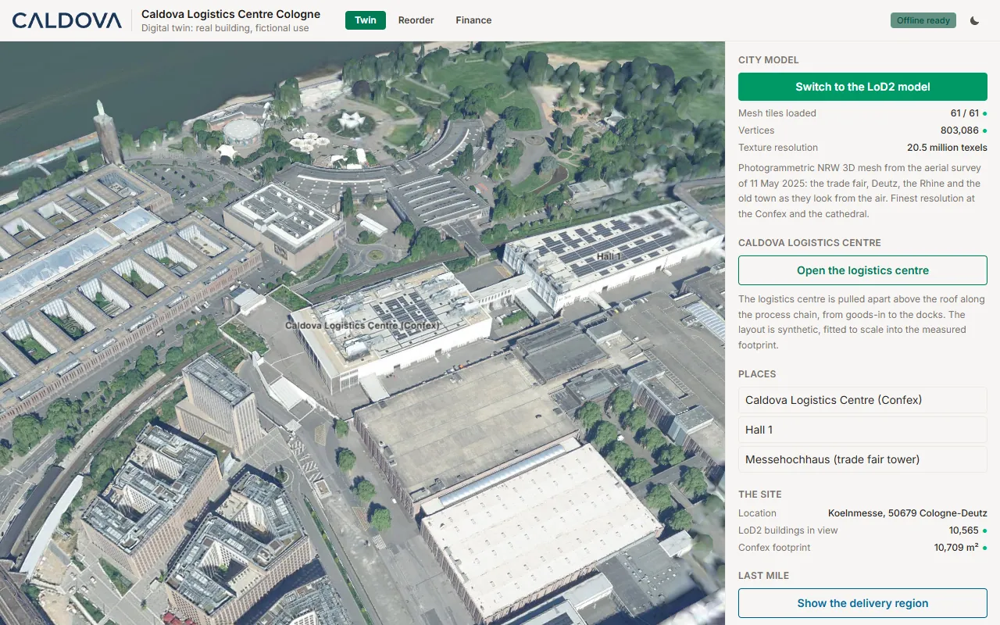
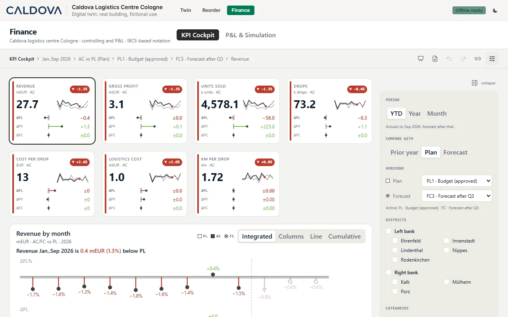

# Caldova Cologne Digital Twin

**A pharmaceutical wholesaler's logistics centre, its delivery fleet and its finances, on a
photoreal 3D twin of a real place in Cologne.**

Caldova is a fictional pharmaceutical wholesaler. In this template its logistics centre sits in the
real Confex building at Koelnmesse, Cologne-Deutz. Trucks and vans leave it in delivery waves and
drive the real Cologne road network to about 120 pharmacies at real OpenStreetMap pharmacy
locations. The building, the terrain, the aerial imagery, the city model and the roads are measured
open data; the company, its use of the building and every operating figure are invented and badged
as such.





The app has three tabs:

| Tab | What it shows |
|---|---|
| **Twin** | The 3D scene: the photoreal Geobasis NRW 3D-Mesh (detailed core, coarser delivery ring), with the LoD2 city model on the orthophoto as a switchable alternative, the logistics centre opened up along its process chain, a 24-hour operating day with a scrubber, and the delivery fleet on real roads |
| **Reorder** | Low-stock queue, sales rates and reorders per pharmacy and district, adapted from the original Caldova app. Reorders are written to the app's own Fabric SQL database |
| **Finance** | An IBCS-style Finance Cockpit and P&L statement over a semantic model derived from the twin's own sales and tours |

Related templates: [caldova-reorder](../caldova-reorder/) (the original Caldova app this tab is
adapted from) and [caldova-finance-ibcs](../caldova-finance-ibcs/) (the Finance Cockpit on its own).

## Credits

- **Original Caldova app:** created by Yohan Lasorsa ([@sinedied](https://github.com/sinedied)) for the
  Microsoft session LTG291,
  [microsoft/frontiertour27-LTG291-turn-your-data-into-production-apps-with-rayfin](https://github.com/microsoft/frontiertour27-LTG291-turn-your-data-into-production-apps-with-rayfin),
  MIT, Copyright (c) Microsoft Corporation. Session documentation and media by Mike Kinsman
  ([@mikekinsman](https://github.com/mikekinsman)). The Reorder tab runs Yohan Lasorsa's original screens,
  and the stock and sales generator is his generator with Cologne inputs.
- **Finance Cockpit and P&L visuals:** Michael Tenner / DatenWG,
  [Losveratos/dwg-cli](https://github.com/Losveratos/dwg-cli), MIT. Vendored under
  `src/finance/vendor`, `src/finance/dwg` and `src/finance/lib/cockpit`.
- **Extensions by Alexander Korn (this template):**
  - the Cologne twin: the Confex logistics centre on the Geobasis NRW 3D-Mesh and LoD2 city model, built
    at setup from open geodata, and the twin engine;
  - the logistics centre opened up along its process chain, the 24-hour operating day and the delivery
    fleet on real Cologne roads to about 120 pharmacies (`tools/data`);
  - the Reorder tab: the original screens re-pointed at the Cologne pharmacies, read from a baked snapshot,
    with reorders written live to the app's own Rayfin SQL database;
  - the Finance tab: Michael Tenner's cockpit ported onto a Caldova finance model derived from the twin's
    own sales and tours, English UI;
  - the optional Fabric back end (lakehouse, two semantic models, snapshot bakes with drift gates) and the
    offline mode.

  The engine is derived from the
  [campus-scheduler](../campus-scheduler/) template and, through it, from
  [paragliding-insights](../paragliding-insights/). Where an engine comment explains a design choice
  with an example from those sites (Regensburg, Tübingen, LMU Munich, the Allgäu, Bavarian survey
  data), it describes the shared engine, not this AOI. `PLAN §…` and `PLAN Phase …` citations in engine
  files point to the engine's own planning notes, which are not part of this template.

## What is real and what is not

The app draws a real building at true scale and puts a fictional company in it, so provenance is part
of the data model rather than a disclaimer:

| Measured (real) | Derived | Fictional (badged as synthetic) |
|---|---|---|
| Terrain, orthophoto, LoD2 buildings, 3D-Mesh (Geobasis NRW) | The hall's roof height, from the NRW nDOM50 over its footprint | Caldova, the company |
| The Confex building's footprint (OpenStreetMap) | Road heights on bridges, from the terrain and the mesh | Caldova's use of the Confex |
| Road network (OpenStreetMap) | Tour routes, routed on the real road graph | Interior layout, machines, volumes, shifts |
| Pharmacy **coordinates** (OpenStreetMap) | Stadtbezirk (district) of each pharmacy | Pharmacy **names**, stock, sales, reorders |
| | Finance figures derived from the twin's sales and tours | Plans, forecasts, prices, margins, costs |

- **Pharmacy locations are real, pharmacy names are fictional.** Nothing in the app claims that a
  real pharmacy is a customer of any wholesaler.
- **The Confex is a real building, its use here is fictional.** Koelnmesse has not supplied, reviewed
  or endorsed anything in this template, and no Koelnmesse logos or trademarks are used.
- Demonstration and training only. Not a statement about any real company, building or pharmacy.

## Getting started

Prerequisites:

- Node.js 20, 22 or 24.
- Python 3.12 with the packages in `tools/requirements.txt` (numpy, Pillow, SciPy, pyproj, Shapely,
  Matplotlib; all have wheels for Windows x64 and ARM64, macOS and Linux).
- About 1.5 GB of free disk while building (downloads and caches in `data/` and `cache/`, about
  70 MB of output in `public/terrain/`), and about 15 to 20 minutes for the first build on a good
  connection (measured: 15.5 minutes for `data:geo`, under 2 minutes for `data:ops`; most of it is
  waiting on Overpass).
- Outbound HTTPS to: `www.opengeodata.nrw.de` (DGM1, nDOM50, LoD2, 3D-Mesh), `www.wms.nrw.de` (DOP
  orthophoto WMS), `copernicus-dem-30m.s3.eu-central-1.amazonaws.com` (Copernicus DEM),
  and the public Overpass API instances `overpass-api.de`, `overpass.kumi.systems` and
  `overpass.private.coffee` (OpenStreetMap). Overpass is shared and rate-limited, and on a busy day
  it answers with 502/504 for minutes at a time; the scripts retry and fall back between instances.
  If one still gives up, run `npm run data:build` again: finished steps are cached.

```bash
npm ci

python -m venv .venv
.venv/Scripts/activate              # or: source .venv/bin/activate
pip install -r tools/requirements.txt
```

### 1. Build the geodata (once, at setup)

`public/terrain/` is not in the template. It is built from the open sources listed in
[NOTICE.md](NOTICE.md), with the virtual environment active (the npm scripts call `python` from
`PATH`):

```bash
npm run data:build
```

`data:build` runs two commands, which can also be run on their own:

1. `npm run data:geo`: the geodata pipeline, `tools/geodata/pipeline.py --aoi koeln-messe`
   (`--list` shows every step, `--from-step <name>` resumes, `--only <name>` reruns one):

   | Steps | Output in `public/terrain/koeln-messe/` |
   |---|---|
   | `places`, `dgm1-nrw`, `terrain` | `heightmap.u16/.json`, `heightmap_nodata.u8`: 4 m core terrain from Geobasis NRW DGM1 |
   | `copdem`, `shell` | `shell.u16/.json`: the coarse terrain around the core, Copernicus DEM GLO-30, with the measured seam offset |
   | `verify` | Gate: terrain registration against published elevations. Stops the build if wrong |
   | `osm-landuse`, `landuse` | `landuse_2m.u8z`, `landuse.json`: OpenStreetMap land cover for the surface colour |
   | `ndom-nrw`, `vegetation-ndom-nrw` | `vegetation.bin/.json`: trees from the NRW nDOM50 surface model |
   | `lod2-nrw`, `drape-nrw`, `buildings` | `drape.jpg/.json` (DOP orthophoto), `buildings_lod2.bin/.json`, `buildings_colour.bin`, `buildings_roof_spans.bin` (LoD2 city model, roof colours measured from the orthophoto) |
   | `water` | `water.bin/.json`: Rhine surface from the OpenStreetMap water polygons (shown with the LoD2 model; the 3D-Mesh carries the river in its own photograph) |
   | `mesh-core-nrw`, `mesh-core-bake-nrw` | `mesh/` (61 GLB tiles) and `mesh.json`: the photoreal Geobasis NRW 3D-Mesh over the core, texture-targeted to 0.25 m at the logistics centre, 0.5 m at the Dom, 1.6 m within 3.5 km and 3 m elsewhere |
   | `mesh-verify-nrw` | Gate: the baked mesh against DGM1 and nDOM50, vertically (mode of mesh minus DGM1 on bare ground, 0.5 m at the logistics centre, 1.0 m over the core) and horizontally (best XY match at zero shift). Stops the build if wrong |
   | `mesh-ring-nrw`, `mesh-ring-bake-nrw` | `mesh-ring/` (80 GLB tiles): the coarse 3D-Mesh level (about 5 m texel) for the delivery ring around the core |
   | `dgm1-ring-nrw` | DGM1 over the whole ring in `data/dgm1/`, for the road heights in the next command |

   **The 3D-Mesh is range-fetched, not downloaded.** Geobasis NRW publishes the Cologne mesh
   (`Mesh_KB1450T12_nw_2025`, flown 2025-05-11, dl-de/zero-2-0) as one SLPK (I3S scene layer
   package) of about 220 GB. `tools/geodata/fetch_nrw_mesh.py` reads its 140 MB central directory
   once, caches it under `cache/mesh/`, picks the nodes whose texel size meets the targets above and
   fetches only those with HTTP Range requests. `bake_nrw_mesh.py` turns them into quantised GLB
   tiles in the scene's own frame (EPSG:25832, DHHN2016, the same as DGM1, so no height shift),
   clips them to the core (or the ring) with a 5 m overlap and downsamples the textures.

2. `npm run data:ops`: the operations data: pharmacy locations, road graph, districts, the logistics
   centre and its operating day (`public/terrain/koeln-messe/operations.json`), stock and sales,
   and finance tables (`data/operations/koeln-messe/`). A gate, `tools/verify_bridge_decks.py`,
   checks that the vans cross the Deutzer Brücke and the Severinsbrücke on the photographed deck of
   the 3D-Mesh. `data:ops` never touches the shipped snapshots in `public/data/`.

   The pharmacy sample follows live OpenStreetMap: 120 of the pharmacies within 6 km, picked by a
   seeded hash of their OSM ids and numbered by distance. The shipped snapshots were baked from the
   October 2026 data. A build in November 2026 placed 118 of the 120 at identical coordinates and
   moved two by 24 m and 35 m (one edited, one replaced OSM object), with the same ids. Pharmacies
   opening or closing later can change which 120 are drawn and renumber them; the twin then no longer
   matches the snapshots store for store until they are re-baked (step 3).

Every step caches its downloads and is safe to re-run. `data/`, `cache/` and `public/terrain/` are
git-ignored.

### 2. Run the app

```bash
npx vite                            # http://localhost:5173
```

`npx vite` runs without Fabric. `npm run dev` does the same after a Rayfin pre-hook
(`rayfin env`) that needs a signed-in Rayfin CLI.

**The Reorder and Finance tabs work offline by default.** They read two baked snapshots that ship
with the template, `public/data/reorder/snapshot.json` and `public/data/finance/snapshot.json`,
which hold the answers of the semantic models to every query the tabs send. Outside a Fabric
deployment the Reorder tab is read-only and says so.

For a venue without good WiFi, `npm run offline` (or `Start-Offline.cmd`) builds once and serves the
twin from `dist/` at `http://127.0.0.1:5196`; a service worker keeps it available offline. This
launcher is **Windows only** (PowerShell with Windows networking cmdlets). On macOS or Linux run
`npm run build` and then `npx vite preview --port 5196`.

### 3. Optional: your own Fabric back end

The `tools/fabric/` scripts create a lakehouse, write the generated tables into it, publish the two
Direct Lake semantic models from `fabric/` and re-bake the snapshots from them. They read the target
from one git-ignored file. They need the extra Python packages in `tools/requirements-fabric.txt`
(`deltalake` and `pyodbc` have no wheels for every platform, Windows on ARM64 among them) and, for
`seed_reorders.py`, the Microsoft ODBC Driver 18 for SQL Server:

```bash
pip install -r tools/requirements.txt -r tools/requirements-fabric.txt   # deltalake, pyarrow, pyyaml, pyodbc
cp tools/fabric/target.example.json tools/fabric/target.json   # set workspaceId (tenantId optional)
az login

python tools/fabric/setup_lakehouse.py                  # lakehouse caldova_cologne
python tools/fabric/build_lakehouse_tables.py           # stores, products, inventory, sales, tours, ...
python tools/fabric/build_finance_tables.py             # fin_* tables for the Finance tab
python tools/fabric/publish_model.py                    # caldova-cologne-operations
python tools/fabric/publish_model.py --model finance    # caldova-cologne-finance
python tools/fabric/verify_model_agreement.py           # Python == DAX, exit 1 on any difference
python tools/fabric/verify_finance_agreement.py
python tools/fabric/bake_reorder_snapshot.py            # rewrites public/data/reorder/snapshot.json
python tools/fabric/bake_finance_snapshot.py            # rewrites public/data/finance/snapshot.json
```

Each script records the item ids it creates back into `tools/fabric/target.json`. Run them with
`--check` (the bake scripts) before a deploy to fail on drift between the model and the shipped
snapshot.

The shipped snapshots carry the English table, column and measure names that the setup above
creates. `src/finance/lib/__tests__/snapshot-coverage.test.ts` proves that every query the app sends
is in the snapshot with the columns the app reads. A re-bake against your own models replaces both.

### 4. Deploy to Fabric

```bash
npx rayfin login
npx rayfin up
```

`rayfin up` creates the app, its SQL database (for reorders) and the static hosting. After the first
deploy, put the SQL database id into `appSqlDatabaseId` in `tools/fabric/target.json`, seed the
reorder history with `python tools/fabric/seed_reorders.py`, and re-run `publish_model.py` so the
operations model reads reorders from the app's database. Add your deployed host to
`services.auth.allowedRedirectUris` in `rayfin/rayfin.yml` if you sign in from it.

`python tools/verify_no_owner_lock.py` checks that the build adds no connector or Functions binding,
which would make the deployed app open only for its owner.

> **Demo permissions.** The Reorder tab writes with the signed-in user's own session and no Functions,
> so the `RestockRequest` entity grants every signed-in user `create`, `read` and `delete` with no
> policy (see `rayfin/data/RestockRequest.ts`). The requester fields are set by the client, and a
> signed-in caller who goes to the data API directly can read, add or delete any reorder. That is fine
> for synthetic demo data; do not put real orders into it without closing the entity behind a
> function.

## Rayfin capabilities used

| Capability | Use |
|---|---|
| `auth` (Fabric) | Sign-in inside Fabric; the Reorder tab is read-only without it |
| `data` (SQL database) | `RestockRequest` entity (`rayfin/data/`), written by the browser through the Rayfin data client |
| `staticHosting` | The built app, protected asset access |
| `storage`, `functions`, connectors | Not used. A semantic-model connector or a delegated Functions binding makes the deployed app owner-only, so the model's answers are baked into snapshots instead |

## Project structure

| Path | What lives there |
|---|---|
| `src/twin3d/` | The 3D engine: terrain, drape, LoD2 buildings, 3D-Mesh core, vegetation, water, logistics centre interior, tours, vehicles, day cycle, fly controls. Three.js |
| `src/components/` | The shell: header, tabs, side panel, day scrubber, drone HUD |
| `src/config/` | AOI and brand registries |
| `src/geo/` | Coordinate transforms (UTM, scene coordinates) |
| `src/i18n/` | The English UI catalogue (`en.json`), with a reachability test |
| `src/reorder/`, `src/reorder-live/` | Reorder tab: the adapted Caldova screens, snapshot loader and live reorder client |
| `src/finance/` | Finance tab: Finance Cockpit, P&L pages and the vendored DatenWG visuals |
| `config/aoi/koeln-messe.json` | The site: bounding boxes, data sources, attribution, focus places, operations parameters |
| `config/brand/` | Display names for the fictional company |
| `fabric/` | The two semantic models (TMDL): `caldova-cologne-operations`, `caldova-cologne-finance` |
| `public/data/` | Baked snapshots of both semantic models (shipped, default data source) |
| `rayfin/` | Rayfin service configuration and the `RestockRequest` data schema |
| `tools/geodata/` | Geodata pipeline and the NRW 3D-Mesh fetch and bake |
| `tools/data/` | Operations data generators: pharmacies, road graph, districts, operating day, stock, finance |
| `tools/fabric/` | Optional Fabric back end: lakehouse, tables, models, snapshot bakes, agreement gates |
| `tools/finance/` | Query manifest and page spec used by the finance snapshot bake; `dwg-english.mjs` patches the generated `src/finance/dwg` pages to English after every `dwg app page` run |
| `tools/reference/functions-original/` | The original Caldova Functions app, kept for reference only (not deployed) |

## Scripts

| Script | What it does |
|---|---|
| `npm run dev` | Vite dev server (Rayfin pre-hook; use `npx vite` to skip it) |
| `npm run dev:fabric` | `rayfin up` without static hosting, then Vite |
| `npm run build` | `tsc -b` then `vite build` |
| `npm run build:fabric` | The build `rayfin up` runs |
| `npm run preview` | Serve the built bundle |
| `npm run lint` | ESLint 9 flat config |
| `npm test` | Vitest unit suite |
| `npm run data:build` | `data:geo` then `data:ops` |
| `npm run data:geo` | Geodata pipeline for the `koeln-messe` AOI, including the NRW 3D-Mesh and its registration gate |
| `npm run data:ops` | Operations data: pharmacies, road graph, districts, operating day, stock, finance |
| `npm run offline` | Build once and serve the twin locally without a network |

## Licences and attribution

- Twin engine and Cologne twin: MIT, see [LICENSE-engine](LICENSE-engine).
- Reorder tab, adapted from the original Caldova app: MIT, see
  [LICENSE-caldova-reorder](LICENSE-caldova-reorder).
- Finance Cockpit and P&L visuals by Michael Tenner / DatenWG: MIT, see
  [src/finance/LICENSE.datenwg](src/finance/LICENSE.datenwg) and
  [src/finance/LICENSE.cockpit-template](src/finance/LICENSE.cockpit-template).
- Geodata: Geobasis NRW (dl-de/zero-2-0), Copernicus DEM (Copernicus DEM licence), OpenStreetMap
  (ODbL 1.0, © OpenStreetMap contributors). Details and the exact attribution strings are in
  [NOTICE.md](NOTICE.md); the bundled notices are in
  [public/THIRD-PARTY-NOTICES.txt](public/THIRD-PARTY-NOTICES.txt).
- The Finance tab is **based on IBCS notation, not certified**. IBCS is a registered trademark of the
  IBCS Institute.
