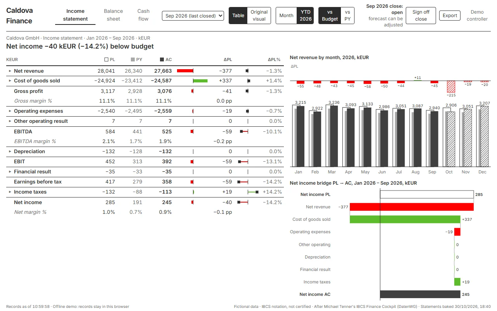

# Caldova Finance: financial statements in IBCS notation

A Rayfin template for Microsoft Fabric. It shows the income statement, balance sheet and cash flow statement of a company in IBCS notation, one screen each, articulated month by month. Controllers adjust the forecast and watch all three statements follow. They comment on variances and sign the month-end close off, and every action is kept on record in Rayfin data.

It ships with Caldova GmbH, a fictional pharma wholesaler with generated data, and runs offline without a tenant.



> **Fictional data.** Caldova is invented; every number is generated by `tools/generate_statements.py`.
> **IBCS®** is a registered trademark of the IBCS Institute. This template is based on IBCS notation and is not certified.

> **Built on the original Caldova sample by Yohan Lasorsa.** Caldova, the fictional pharma wholesaler,
> comes from the Caldova app that **[Yohan Lasorsa (@sinedied)](https://github.com/sinedied)** created for
> the Microsoft session [LTG291](https://github.com/microsoft/frontiertour27-LTG291-turn-your-data-into-production-apps-with-rayfin)
> (MIT; the original app is in [`caldova-reorder`](../caldova-reorder/)). This template is an extension by
> **Alexander Korn**; see [Credits](#credits) for who did what.

## The scenario

Month-end in a controlling team: the actuals of the month are in. The team reviews income statement, balance sheet and cash flow against budget and prior year. It adjusts the forecast of the open months and explains the large variances, then signs the month off and hands an Excel or PowerPoint pack to the board. Today that runs through a report plus Excel files sent around plus e-mail approvals, with nothing on record in one place.

## What it does

| | |
| --- | --- |
| **Three statements, one screen each** | Income statement with a monthly column chart and a net income bridge; balance sheet with its structure and working capital (DSO, DIO, DPO, cash conversion cycle, equity ratio); indirect cash flow with a cash bridge and a visible check that closing cash equals the balance sheet. Pages never scroll: row heights follow the screen, the P&L opens one block at a time. |
| **IBCS only** | AC solid, PY grey, PL outlined, FC hatched; order PL, PY, AC, FC; variances point by their sign and are coloured by their impact (green favourable, red unfavourable, grey where a line has no direction); message titles; one scale per column. No theme switch. |
| **Articulated** | Net income closes into equity, the indirect cash flow reconciles to the balance sheet cash, assets equal equity and liabilities, for every month and scenario (tested). |
| **Forecast adjustments** | An adjustment on a P&L account in an open month flows through taxes, equity, working capital and cash, live in the browser. The engine is checked against a Python oracle with four adjustment sets. |
| **Comments and sign-off** | Comments on any line and month; a controller signs the close off (or reopens it). After sign-off the forecast is frozen. |
| **Excel and PowerPoint** | The three statements plus the adjustment, comment and sign-off logs as `.xlsx`; one IBCS slide per statement as `.pptx`. |

## How it uses Rayfin

- **Rayfin data with row-level policies.** Three append-only entities (`FcAdjustment`, `LineComment`, `MonthSignOff`, create and read only). Their create policies are enforced by the data API itself: the author must be the caller (`@claims.email eq @item.author_email`), and only controllers can sign off (the allow-list is compiled into the policy at deploy time from `CONTROLLER_EMAILS`).
- **Close lock as a read-time rule.** An adjustment counts only if its close was open when it was written. A late write is shown and never applied, whoever saved first (`src/domain/lock.ts`).
- **A Fabric semantic model as the source.** The statements live in a Direct Lake model (`fabric/caldova-finance.SemanticModel`). `npm run bake` reads it with three DAX queries into `public/data/statements.json`, plus every query of the original visual into `public/data/dwg-snapshot.json`; `npm run bake:check` is the drift gate before every deploy. The files are `protected` (Fabric sign-in), so the numbers are not public.
- **Optional live connector mode.** `npm run live:enable` declares a `fabric-semanticmodel` connector and `VITE_LIVE_MODEL=true` reads the model live. Note: a deployed app with this connector opens only for its owner (Rayfin 1.36), which is why the default is the baked snapshot.
- **Dev and prod with GitHub Actions.** `.github/workflows/deploy.yml` tests, runs the drift gate, signs in as a service principal and deploys to a dev item on every push and to the prod item on a release.

## Fabric architecture

| Item | Why |
| --- | --- |
| Static web app (Rayfin static hosting, `protected`) | The front end; its files, including the baked statements, open only after Fabric sign-in |
| SQL database (Rayfin data) | Adjustments, comments and sign-offs, append-only, with row-level create policies |
| Lakehouse and Direct Lake semantic model (optional) | The source of the statements; baked into the app with a drift gate, or read live in connector mode |
| GitHub Actions (optional) | Test, drift gate and deploy to a dev and a prod item |

No backend that holds rights and no Functions in the default build: the browser reads the baked statements and writes its records through the Rayfin data API as the signed-in user.

## Data

Fictional. Caldova GmbH and every number are generated by `tools/generate_statements.py`; no customer data. The shipped snapshot `public/data/statements.json` covers January 2025 to December 2026 in the scenarios AC, PY, PL and FC. With your own model, the numbers come from your tenant, read with your identity.

## Getting started

```bash
npm install
npm run dev:offline        # http://localhost:5173, offline demo: no tenant, records stay in this browser
```

In the offline demo you are a controller: adjust the forecast in the drawer of any P&L line, comment, sign the close off.

To deploy to Fabric:

```bash
npx rayfin login
CONTROLLER_EMAILS=you@contoso.com VITE_CONTROLLER_EMAILS=you@contoso.com \
  npx rayfin up --tenant <tenant-id> --workspace-id <workspace-id> --item-name "Caldova Finance"
```

Add your app host to `allowedRedirectUris` in `rayfin/rayfin.yml` if `rayfin up` did not.

### Bring your own model

1. Shape your model like `fabric/caldova-finance.SemanticModel`: tables `Account` (one tree for PL, BS, CF), `Month`, `Scenario` and a fact `Statement Value` (account × month × scenario).
2. Put your drivers (DSO, DIO, DPO, tax rate, capex, loan schedule, the balances at the last closed month) into `fabric/drivers.json`.
3. Set `FABRIC_TENANT_ID`, `FABRIC_WORKSPACE_ID`, `FABRIC_MODEL_ID` and run `npm run bake`.

### Put the demo data into your own lakehouse and model (optional)

Python 3.11+ with `pyarrow` and `deltalake` (`pip install -r tools/requirements.txt`), az signed in to your tenant,
`tools/fabric/target.json` from `target.example.json`:

```bash
python tools/fabric/setup_lakehouse.py && python tools/fabric/build_tables.py && python tools/fabric/publish_model.py
```

`build_tables.py` reads the shipped `public/data/statements.json`. The generator (`tools/generate_statements.py`)
documents how the balance sheet and cash flow are derived; the P&L it starts from is not part of the template.

### The original P&L visual and the Power BI twin (dwg cli)

Each statement page switches between the app's IBCS table (default, with the actions) and Michael Tenner's original
P&L Statement byDatenWG visual, built with his [dwg cli](https://github.com/Losveratos/dwg-cli). The model carries the
dwg data contract next to the app's tables (`Calendar`, `P&L/BS/CF Account`, `P&L/BS/CF Fact`, English names; written
by `tools/contract_tables.py` and `tools/contract_tmdl.py`, checked by `tools/fabric/verify_contract.py`). One spec,
`dwg/caldova-finance.json` (`node tools/make-dwg-spec.mjs <dwg-cli checkout>`), gives both targets:

```bash
# app pages (dwg app page needs a Rayfin layout with a connector: generate into a scratch skeleton, copy src/dwg and src/vendor)
node dwg.mjs app page --app <skeleton> --spec dwg/caldova-finance.json --connector statements --model fabric/caldova-finance.SemanticModel
node tools/dwg-english.mjs
# Power BI twin
node dwg.mjs pbip new --out fabric/caldova-finance.Report --name "Caldova Finance (Power BI)" --model fabric/caldova-finance.SemanticModel --template "<dwg-cli>/examples/showcase/ZlatyLev Showcase.Report"
node dwg.mjs pbip register --report fabric/caldova-finance.Report --pbiviz <dwg-cli>/visuals/pbiviz/pnlByDatenWG.1.7.0.0.pbiviz
node dwg.mjs pbip pages --report fabric/caldova-finance.Report --spec dwg/caldova-finance.json
node dwg.mjs validate fabric/caldova-finance.Report
python tools/fabric/publish_report.py
```

The app's view has no connector: `src/hooks/use-semantic-model-query.ts` answers the visual's DAX from
`public/data/dwg-snapshot.json`, which `npm run bake` writes (every query the pages can send, built by the app's own
builders in `src/domain/dwgPeriod.ts`) and `bake:check` compares with the model before a deploy. It shows recorded
actuals, so forecast adjustments stay in the table view.

## Project structure

| Path | What it is |
| --- | --- |
| `src/domain/engine.ts` | Forecast engine: applies adjustments, recomputes taxes, rolls balance sheet and cash flow forward |
| `src/domain/statements.ts`, `view.ts` | Tree aggregation, periods (month, YTD), table lines with variances |
| `src/domain/lock.ts` | The close lock as a read-time rule |
| `src/domain/assemble.ts` | The model queries and their mapping (live mode; the bake uses the same) |
| `src/pages/*` | Income statement, balance sheet, cash flow |
| `src/components/StatementTable.tsx`, `charts.tsx`, `ibcs.tsx` | IBCS table, columns, bridges, structure; notation helpers |
| `src/components/ActionDrawer.tsx` | Comments and forecast adjustments for the selected line |
| `src/services/store.ts` | Records in Rayfin data, or in memory for the offline demo |
| `src/services/exports.ts` | Excel and PowerPoint |
| `src/components/OriginalStatement.tsx`, `src/domain/dwgPeriod.ts` | The original-visual view: period slice, queries, sizing |
| `src/dwg/`, `src/vendor/` | Generated by dwg cli: pages and the built byDatenWG visuals (do not edit by hand) |
| `dwg/caldova-finance.json` | The dwg spec for the app view and the Power BI twin |
| `rayfin/data/*.ts` | Entities with row-level policies; `controllers.ts` reads `CONTROLLER_EMAILS` |
| `fabric/` | The Direct Lake model (incl. the dwg contract tables), the Power BI twin, the forecast drivers |
| `tools/` | Generator, bake and drift gate, Fabric setup, live mode switch, browser probe |
| `.github/workflows/deploy.yml` | Test, drift gate, dev and prod deployments |

## Scripts

| Script | What it does |
| --- | --- |
| `npm run dev:offline` | Offline demo, no tenant |
| `npm run dev` | Local Rayfin services and Vite |
| `npm run build` / `build:fabric` | Type-check and build |
| `npm test` | Unit tests: engine vs oracle, articulation, lock, store, live assembly |
| `npm run lint` | ESLint |
| `npm run bake` / `bake:check` | Bake the statements and the original visual's answers from the model / drift gate |
| `npm run probe` | Headless Edge proof: no scroll at 1366 and 1920 px, the action flow end to end |
| `npm run live:enable` / `live:disable` | Switch live connector mode on or off |
| `npm run rayfin:up` | Deploy |

## Limits

- The records are written from the browser. Row policies make sure nobody writes under someone else's address and only controllers sign off, but a signed-in user can still add rows through the API; the lock rule decides what counts (only the current close, only what a sign-off froze), and records are attributed by address.
- Simplified balance sheet: no VAT, no revolving credit; receivables, inventories and payables follow stated days.
- Taxes per month on positive earnings before tax, no loss carry-forward or annual true-up.
- A new close (next month's actuals) starts a new forecast version: adjustments of earlier closes are kept on record but no longer applied.
- The controller list is also in the app bundle (to show the button); every signed-in user can see it.
- English only.

## Credits

- **Original Caldova sample:** Yohan Lasorsa ([@sinedied](https://github.com/sinedied)), Microsoft session
  [LTG291](https://github.com/microsoft/frontiertour27-LTG291-turn-your-data-into-production-apps-with-rayfin),
  MIT, Copyright (c) Microsoft Corporation. This template takes the fictional company from it; the original
  app is in [`caldova-reorder`](../caldova-reorder/).
- **IBCS approach, Finance Cockpit and P&L visual:** Michael Tenner (DatenWG), shown at the Daten-WG Conference
  2026; his MIT notice is in `NOTICE`. The notation helpers and the structure of the Excel and PowerPoint
  exports are adapted from his cockpit. The original-visual view and the Power BI twin use his
  [dwg cli](https://github.com/Losveratos/dwg-cli) and its built P&L Statement byDatenWG visual (MIT).
- **Extensions by Alexander Korn (this template):** the three articulated statements for Caldova (income
  statement, balance sheet, indirect cash flow) and their generated data; the forecast engine that carries an
  adjustment through taxes, equity, working capital and cash, checked against a Python oracle; comments,
  month-end sign-off and the close lock on Rayfin data with row-level policies; the offline demo; the Fabric
  lakehouse, Direct Lake model and report with the bake and drift gate; the GitHub Actions deployment.

## License

MIT, see `LICENSE` and `NOTICE`.
