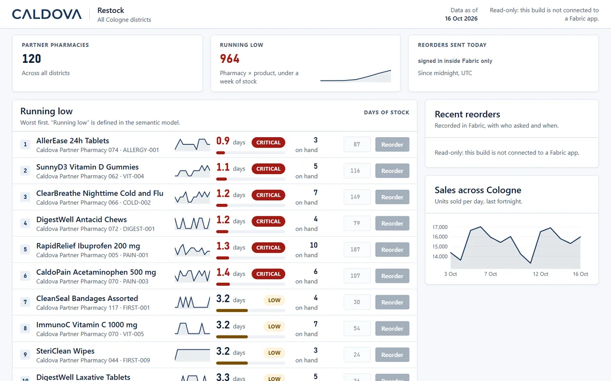

# Caldova Reorder

The app a Caldova regional manager uses to see what is running low across their
stores and send a reorder to purchasing. Built with [Rayfin](http://aka.ms/rayfin/docs)
on top of the `caldova-operations` semantic model in [`fabric/`](fabric/).



*These screens as they run in the Reorder tab of the
[caldova-cologne-digital-twin](../caldova-cologne-digital-twin/) template, read-only on a baked snapshot. This
template itself runs inside the Fabric portal against the live semantic model.*

> **Original sample by Yohan Lasorsa.** This is the Caldova app from the Microsoft session
> [LTG291: Turn your data into production apps with Rayfin](https://github.com/microsoft/frontiertour27-LTG291-turn-your-data-into-production-apps-with-rayfin).
> The app, the semantic model, the data generator and the deploy scripts were created by
> **[Yohan Lasorsa (@sinedied)](https://github.com/sinedied)**; session documentation and delivery by
> **[Mike Kinsman (@mikekinsman)](https://github.com/mikekinsman)**.
> The code is Copyright (c) Microsoft Corporation under the MIT license in [`LICENSE`](LICENSE); that
> license covers the code only. This README, [`fabric/README.md`](fabric/README.md) and
> [`data/README.md`](data/README.md) are adapted from the original repository's documentation and, together
> with the changes made to them here, are licensed under
> [CC BY-SA 4.0](https://creativecommons.org/licenses/by-sa/4.0/), as the original's
> [LICENSE-DOCS](https://github.com/microsoft/frontiertour27-LTG291-turn-your-data-into-production-apps-with-rayfin/blob/main/LICENSE-DOCS)
> requires.

### Changes in this template (Alexander Korn)

The application code, the model, the data generator and the deploy logic are the original's
(commit `646a38f`), unchanged. Only the packaging is new:

- the app moved from `src/caldova-reorder/` to the template root, with `deploy.ps1`, `deploy.sh` and
  `.env.example` re-pointed at the new paths;
- gallery metadata: the `template` block in `package.json`, `manifest.json` and `rayfin-template.yml`;
- `npm test` runs vitest on `src/` only and the data generator's own `node:test` suite, which vitest
  used to pick up and fail on;
- this header, the screenshot and the note on the data API in
  [Where row-level security lives](#where-row-level-security-lives).

## The Caldova templates

| Template | What it is |
| --- | --- |
| [`caldova-cologne-digital-twin`](../caldova-cologne-digital-twin/) | **The combined app.** One app with three tabs: a photoreal 3D twin of Caldova's logistics centre in Cologne and its delivery fleet, these Reorder screens on Cologne pharmacies, and an IBCS Finance Cockpit with P&L. |
| [`caldova-reorder`](../caldova-reorder/) (this template) | The original Caldova app by Yohan Lasorsa, on its own. Runs inside the Fabric portal against the live semantic model. |
| [`caldova-finance-ibcs`](../caldova-finance-ibcs/) | A standalone finance app: income statement, balance sheet and cash flow in IBCS notation, with forecast adjustments, comments and sign-off. It shares Michael Tenner's IBCS building blocks with the twin's Finance tab but is a separate app. |

The two extensions are by Alexander Korn.

All Caldova stores, products, stock, sales and reorders are synthetic, generated
by [`data/generate.js`](data/generate.js) from a fixed seed. There is no patient or
clinical data.

## Getting started

You need Node.js 20+, a Fabric workspace on a capacity, the [Rayfin CLI](http://aka.ms/rayfin/docs)
(installed as a dev dependency) and the `fabio` CLI signed in to your tenant. The deploy
scripts never create a workspace and never sign you in.

1. **Configure.** `npm ci` (the lockfile pins the Rayfin alpha line; see *Deploying* below).
   Copy `.env.example` to `.env` and set `FABRIC_WORKSPACE_ID` or `FABRIC_WORKSPACE_NAME`.
2. **Deploy the app.** `npx rayfin login`, then
   `RAYFIN_FEATURE_FLAGS=functions,connectors npx rayfin up`. This creates the app and its
   SQL database. Copy the app's SQL database and SQL endpoint ids
   (`fabio item list --workspace <workspace> --all`) into `.env` as
   `RAYFIN_SQL_DATABASE_ID` and `RAYFIN_SQL_ENDPOINT_ID`.
3. **Deploy data and model.** Run `./deploy.ps1 -DryRun` then `./deploy.ps1` (PowerShell),
   or `./deploy.sh --dry-run` then `./deploy.sh` (bash). It generates the synthetic data,
   creates the `caldova` lakehouse, loads the four Delta tables, deploys the
   `caldova-operations` Direct Lake model with `RestockRequests` bound to the app's mirrored
   database, seeds the reorder history and writes the resolved ids back into `.env`.
4. **Point the connector at the model.** Replace `<fabric-workspace-id>` and
   `<semantic-model-item-id>` in [`rayfin/rayfin.yml`](rayfin/rayfin.yml) with the workspace
   and `FABRIC_SEMANTIC_MODEL_ID` from `.env`, then run `rayfin up` again.
5. **Open it.** Open the app item in the Fabric portal. For local development run
   `npm run dev` and append `&devUri=http://localhost:5173` to the app item URL.

## Project structure

| Path | What it is |
| --- | --- |
| `src/` | React app: regional dashboard, low-stock queue, product detail, reorder flow |
| `src/queries/` | The DAX the app sends through the `caldovaModel` connector, one `.dax` file per query |
| `rayfin/rayfin.yml` | Auth, data, static hosting, functions and the `caldovaModel` semantic-model connector |
| `rayfin/data/` | The `RestockRequest` entity the app writes |
| `rayfin/functions/` | `sendReorder`, `resetDemoReorders` and the stood-in `purchaseOrders` endpoint |
| `fabric/` | The `caldova-operations` semantic model (TMDL) and smoke-test DAX, see [`fabric/README.md`](fabric/README.md) |
| `data/` | Deterministic synthetic data generator and the generated CSVs, see [`data/README.md`](data/README.md) |
| `deploy.ps1`, `deploy.sh` | Lakehouse, tables, model and reorder seed into an existing workspace (keep the two in step) |
| `.agents/` | Agent skills for extending the app (DAX, visuals, Rayfin connectors) |

## Scripts

| Script | What it does |
| --- | --- |
| `npm run dev` | Vite dev server on port 5173 (runs `rayfin env` first) |
| `npm run build` | Type-check and production build to `dist/` |
| `npm run build:fabric` | The build `rayfin up` uses for static hosting |
| `npm run lint` | ESLint |
| `npm test` | Vitest unit tests |
| `npm run test:fabric` | Opens the deployed app item in the Fabric portal |
| `./deploy.ps1`, `./deploy.sh` | Data, lakehouse and semantic model deployment (see Getting started) |

## How it hangs together

**Reads** go through the Rayfin `fabric-semanticmodel` connector, declared as
`caldovaModel` in [`rayfin/rayfin.yml`](rayfin/rayfin.yml):

```ts
client.connectors.caldovaModel.executeQuery({ query })
```

The connector runs with **delegated** auth, so the model's `RegionalManager`
row-level security scopes every query to the signed-in manager's region. The app
never filters by region itself.

The model answers in Apache Arrow, so the client is constructed with the
connector's runtime (`fabricSemanticModel()`) registered under the same name —
see [`src/lib/rayfin-client.ts`](src/lib/rayfin-client.ts). That runtime decodes
the response and returns a normalised `{ status, table }` result, so app code
never touches the wire format.

Every number on screen is a model measure — `Days of Stock`, `Is Low Stock`,
`Suggested Reorder Units`, `Reorders Sent Today`. Change a definition in the
semantic model and this app changes with it, with no code edit here. The DAX
lives in [`src/queries/regional-dashboard/`](src/queries/regional-dashboard/).

**Writes** go through a function, never a direct client write:

```ts
client.functions.sendReorder.invoke({ storeId, sku, units })
```

[`rayfin/functions/src/function_app.ts`](rayfin/functions/src/function_app.ts)
does two things: it calls Caldova's purchasing system, then records the request
with who asked and when. The identity comes from the session token, not from the
caller.

Purchasing itself is stood in by a second function, `purchaseOrders`
([`purchasing-mock.ts`](rayfin/functions/src/purchasing-mock.ts)), hosted in the
same workspace. The outbound call is therefore a real HTTP round trip — real
client, real request shape, real error handling — with nothing outside Fabric to
depend on at a venue. Point `PURCHASING_API_URL` at the real system to switch.

The recorded request lands in the app's own Fabric SQL database. Fabric mirrors
that into OneLake as Delta, and the semantic model reads it with Direct Lake — so
a reorder shows up in the app, the regional dashboard and analytics as one number.

## Deciding how many to order

Clicking a row opens a detail view with the three things that turn a suggested
quantity into a decision: what the product actually sells here and across the
region (last 7 or 28 days), how much cover is left, and how stock has moved in
**every** shop over the past week — fifteen small multiples, worst cover first,
this shop in bold.

`Inventory` is a snapshot with no history, so the stock curves are *reconstructed*:
today's count plus everything sold since. That assumption — no deliveries in the
window — is stated on screen and in each measure's description. The measures
themselves live in the semantic model (`Estimated Stock`,
`Estimated Days of Stock`, `Estimated Products Running Low`, `Avg Daily Sales`),
not in this app, so a report or a notebook asking the same question gets the same
answer. Over the model's own 28-day window `Avg Daily Sales` reproduces
`Avg Daily Demand` exactly.

The "products running low" tile plots that same reconstruction, so the chart and
the number above it are finally the same quantity — the last point of the trend
*is* the tile's number.

The line charts are **plain SVG**, not Vega. They were Vega once, and any
re-layout — switching tab, opening the detail view, resizing — could leave a view
collapsed to a flat line with nothing to restore it. Opening the modal removes
the body scrollbar, every row's width shifts, the view rebuilds, and some
rebuilds never come back. Plain SVG has no lifecycle to get stuck in. Vega still
draws the fifteen faceted store panels, where it earns the dependency and where
fixed-width panels never had the problem. A genuinely unchanging series is drawn
down the middle, so "steady" cannot be mistaken for "failed to draw".

| Path | File |
| --- | --- |
| Data model | [`rayfin/data/RestockRequest.ts`](rayfin/data/RestockRequest.ts) |
| Where "running low" is read from | [`src/queries/regional-dashboard/low-stock-queue.dax`](src/queries/regional-dashboard/low-stock-queue.dax) |
| The reorder function | [`rayfin/functions/src/function_app.ts`](rayfin/functions/src/function_app.ts) |
| Product detail | [`src/components/product-detail.component.tsx`](src/components/product-detail.component.tsx) |
| Line charts (SVG) | [`src/components/line-chart.tsx`](src/components/line-chart.tsx) |
| Faceted store panels (Vega) | [`src/components/vega-charts.tsx`](src/components/vega-charts.tsx) |

## Why the screen moves before the model does

Fabric mirrors the app's database into OneLake, and the semantic model reads that
copy. The mirror takes roughly half a minute — far too long to leave the screen
still after a manager acts.

So a sent reorder is held in [`use-pending-reorders`](src/hooks/use-pending-reorders.tsx)
and painted immediately: the row flips to **On order**, the tile increments, the
row appears in recent reorders. Each pending entry is dropped the moment the
model reports its `requestId`, so nothing is ever counted twice. Nothing is
invented — the app is anticipating an answer it already knows the model will give.

A reorder does not restock the shelf, so `Days of Stock` deliberately does **not**
change on send. The row's honest state change is "On order".

That badge is **not** session state. It comes from the model's own
`Open Restock Requests` measure — sent to purchasing, not yet fulfilled — so it
survives a refresh, and a colleague's open request stops you double-ordering
too. Pending only fills the half-minute before the model has mirrored a reorder
just sent from this screen, and a pending entry is released only once the model
reports it in *both* places it is painted, so the badge never blinks off.

## Where row-level security lives

`RestockRequest` carries no database policy, on either action. Two reasons, both
recorded on the entity:

- Data API Builder cannot apply one to `create` — an INSERT has no WHERE clause
  to attach it to.
- A `read` policy would have to match on `claims.sub`, and the Fabric-brokered
  session token does not carry that claim. Data API Builder applies read rules to
  the row a mutation returns, so an unevaluable policy breaks the **write** too.

Neither is a gap. Writes only ever happen inside `sendReorder`, which takes the
requester from the signed-in identity rather than from the caller, so a reorder
cannot be attributed to somebody else. And what a manager *sees* is scoped by the
semantic model's own `RegionalManager` row-level security — which is the point
the session is making: the rule lives in the model, once.

> **Note added in this template (Alexander Korn).** The paragraph above holds for the paths the app
> uses. The Rayfin data API itself is wider: `RestockRequest` grants every signed-in user `create`,
> `read` and `delete` with no policy, so a signed-in caller who goes to the data API directly can read
> every region's reorders, write a row with any `requested_by`, or delete another manager's rows. The
> model's row-level security does not protect that API. That is fine for a demo on synthetic data;
> before real use, move writes and deletes behind a function and close the entity to direct access.

## Resetting between runs

Double-click the Caldova wordmark. It asks first, then removes **the reorders you
sent** — the seeded history raised by other managers stays, so the recent list is
never left bare.

There is no button on screen for this on purpose: an audience never finds it, and
a presenter does not have to look at a reset control all the way through a talk.
The confirmation is equally deliberate — an accidental double-click wiping the
table mid-demo would be worse than having no reset at all.

Scoping is by `requested_by_id`, taken from the signed-in identity inside
[`resetDemoReorders`](rayfin/functions/src/function_app.ts). It cannot be a Data
API Builder policy, for the same reason `read` has none: the policy would match on
`claims.sub`, a claim the Fabric-brokered session token does not carry.

## Running it

```bash
npm install
npm run dev
```

The app authenticates with Fabric SSO and **only runs embedded in the Fabric
portal**. Open the app item in the workspace and append `&devUri=http://localhost:5173`
to point the shell at your local dev server.

## Deploying

Before deployment, replace `<fabric-workspace-id>` and
`<semantic-model-item-id>` in [`rayfin/rayfin.yml`](rayfin/rayfin.yml) with the
workspace and semantic model IDs created by the root deployment scripts. Rayfin
requires literal connector IDs; environment-variable placeholders are not
supported for these fields.

```bash
npx rayfin login
RAYFIN_FEATURE_FLAGS=functions,connectors npx rayfin up
```

`rayfin up` deploys the frontend, the function and the schema, and applies the
runtime settings in one step.

One part of this project is still behind feature flags:

- Functions and connectors are preview features — export
  `RAYFIN_FEATURE_FLAGS=functions,connectors` for the CLI to see them.

`services.staticHosting.assetAccess` and `services.staticHosting.embedded.only`
are a **pair**, and this app needs `protected` + `only: true`.

The host rejects `embedded.only: true` alongside `assetAccess: public`, because an
embedded app has no standalone surface to make public. Setting `protected` on its
own — without declaring the app embedded-only — leaves the posture half-stated and
sign-in fails. Change one, change the other.

The Rayfin packages are pinned to the `1.36.0-alpha.*` line. Install with
`npm ci` so the lockfile decides the versions — a plain `npm install` can pull a
newer alpha, and this line still makes breaking changes between builds.

No secrets are required: `PURCHASING_API_URL` is optional and falls back to the
stood-in endpoint in this workspace. To point at a real purchasing system, set
`RAYFIN_SECRET_PURCHASING_API_URL` in `rayfin/.env` and run `npx rayfin secret set`.

After deploying, copy the app's SQL database and SQL endpoint ids into the repo
root `.env` as `RAYFIN_SQL_DATABASE_ID` and `RAYFIN_SQL_ENDPOINT_ID` so the
semantic model deploy can bind to them.
