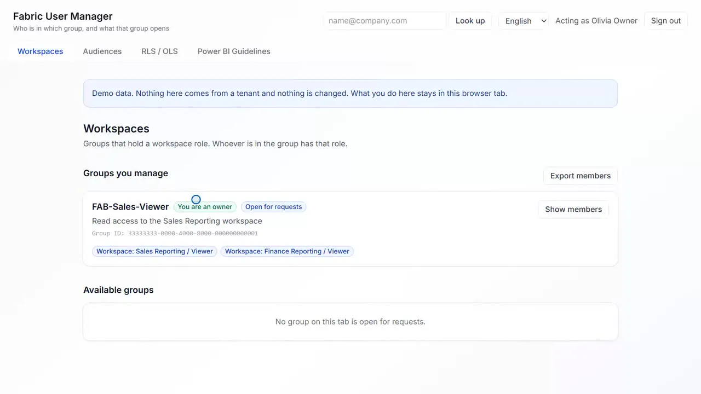

# Fabric User Manager

Owners manage who is in the groups behind workspace roles, app audiences and RLS/OLS; colleagues ask for access with a reason; the Power BI house rules live in the same app. It runs as the signed-in person, so nobody can do more here than they already could in Entra and Fabric.



Three-minute video: https://youtu.be/1NQXngCOqIw

## What it does

Access in Fabric comes in three parts: workspace roles (who may build), app audiences (who may read) and row or object level security (who sees which data). In all three the clean way is the same: the access goes to an Entra group, and people go into the group. So access management is group management, and the person who knows who belongs in a group is its owner.

- **Three tabs for the three parts**: Workspaces, Audiences, RLS / OLS. Each lists the groups you own and the groups that are open for requests, and what each group opens.
- **Owners add and remove members** of their own groups. A check says what the person will get before anything happens.
- **Requests and approvals**: a colleague asks for a group with a reason, an owner approves, the person is added, and it is on record who decided and when. The request states that the Power BI Guidelines were read.
- **Power BI Guidelines** as a fourth tab: three areas (data integration, data modeling, data visualization), 19 topics, 169 rules and 26 drawings, in English and German. An app admin answers up to fifty optional questions in Setup, and the answers are filled into the text for everyone.
- **Setup for app admins**: activate the groups people should manage, record which audience or security role a group stands for, three separate switches for member changes, role bindings and creating groups, a log of the app's own records, Excel export and import.

## Fabric architecture

No service principal and no backend that holds rights. The browser talks to Microsoft Graph and the Fabric REST API with the signed-in person's own token; Entra and Fabric decide what that person may do. The app's own records are kept in a Fabric SQL database through Rayfin.

| Item | Why |
|---|---|
| Static web app | the front end, served by Rayfin static hosting |
| SQL database | the app's own records: activated groups, requests, review dates, contacts, log, settings |
| Entra sign-in | Fabric identity for Rayfin, plus one app registration of your own for Graph |

What it never stores: members, owners and workspace roles. Those are read live every time.

## Getting started

Try it without a tenant first. The offline demo uses invented people and groups and keeps what you do in the browser tab:

```bash
npm install
VITE_UM_MOCK=true VITE_UM_WRITES=true npx vite
```

Open `http://localhost:5173/?as=admin`, `?as=owner` or `?as=user`. File a request as the user, approve it as the owner, read the log as the admin.

Then deploy it to your own workspace. It needs one app registration in Entra and an administrator's consent; [the setup guide](docs/FABRIC-USER-MANAGER-SETUP.md) walks through both.

```bash
cp .env.example .env        # client id of your registration, first app admin, VITE_UM_WRITES=true
npx rayfin login --tenant <your-tenant-guid>
npx rayfin up --tenant <your-tenant-guid> --workspace-id <your-workspace-guid> --dry-run
npx rayfin up --tenant <your-tenant-guid> --workspace-id <your-workspace-guid>
```

Deploy it to an item of its own. Everything that changes something stays off until an app admin switches it on in Setup. A guide for owners and requesters: [docs/FABRIC-USER-MANAGER-GUIDE.md](docs/FABRIC-USER-MANAGER-GUIDE.md).

## Project structure

```
src/
  App.tsx, main.tsx     sign-in and the routes
  um/components/        the tabs, Setup, requests, the guidelines page and questionnaire
  um/domain/            pure rules: views, eligibility of groups, requests, member and role changes
  um/services/          Graph and Fabric reads and writes, the app's store, the offline demo
  um/guidelines/        the guideline content (English and German), questions, drawings
  i18n/                 all visible text, English and German
  __tests__/            unit and view tests, including the offline demo end to end
rayfin/
  rayfin.yml            Rayfin services: Fabric sign-in, SQL data, static hosting
  data/                 the app's tables as typed entities
docs/                   setup guide and guide for owners and requesters
```

## Scripts

| Script | What it does |
|---|---|
| `npm run dev` | Rayfin backend for local development, then the Vite dev server |
| `npm run build` | type check and production build |
| `npm run test` | unit and view tests (Vitest) |
| `npm run lint` | ESLint |
| `npm run preview` | serve the production build locally |
| `npm run rayfin:up` | deploy with the Rayfin command line |

## Data

Your own tenant, read with your own identity. Nothing is bundled. The offline demo's people, groups and workspaces are invented and marked as demo data in the app.

What the app cannot read, it says: who an app audience is shared with needs a Fabric administrator, and members of semantic model roles cannot be read through a supported API. For those two, an app admin records which group stands for the audience or role, and the app marks it as recorded, not verified.

## Credits

Request and approval patterns adapted from [DaSenf1860/fabricplatformgovernance](https://github.com/DaSenf1860/fabricplatformgovernance) by Andreas J. Rederer (MIT). The Power BI Guidelines build on the Power BI Fixer's guidelines and the Tabular Style Guide. Built on [Rayfin](https://github.com/microsoft/awesome-rayfin) and Microsoft Fabric. MIT licence.
